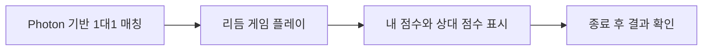

# Photon 기반 1대1 리듬 게임

## 경쟁 플레이를 추가한 이유

혼자 음악에 맞춰 기록을 쌓는 리듬 게임에, 다른 사용자와 점수를 겨루는 재미를 더하고자 했습니다. Photon 예제 코드를 바탕으로 실시간 1대1 매칭과 리듬 게임 플레이 환경을 직접 구현했습니다.

## 구현한 범위

- Photon 예제와 리듬 게임을 연결한 실시간 1대1 플레이
- 플레이 중 내 점수와 상대 점수 표시
- 종료 후 개별 판정 기록과 내 점수·상대 점수 표시

Photon의 네트워크 라이브러리 자체와 예제 원본을 직접 개발한 것으로 표현하지 않습니다. 해당 기반을 게임에 연결하는 응용 구현을 담당했습니다. 기존 C++ 로그인·기록 서버 연동과는 별개의 작업입니다.

## 사용자 흐름

이 그래프는 구현 결과의 사용자 흐름을 설명하며 실제 클래스 구성이나 패킷 순서를 의미하지 않습니다.

## 확인한 결과

두 클라이언트를 실행한 플레이 화면에서 내 점수와 상대 점수가 서로 대응하는 모습을 확인했습니다. 종료 후 결과 화면에서도 각자의 판정 기록과 두 플레이어의 최종 점수를 확인할 수 있었습니다.

두 화면이 같은 진행 시간을 표시한다는 사실만으로 프레임 단위 시각 동기화나 지연 보정을 증명하지는 않습니다. 이 사례에서는 정밀 시간 보정, 서버 권위 판정, 재접속 처리, 랭킹 서비스 구현 여부를 단정하지 않습니다.

## 공개 범위

회사명과 실제 게임명, 원본 소스와 에셋, 실제 플레이·결과 화면은 이 저장소에 포함하지 않습니다. 여기서는 담당 구현과 사용자 흐름을 익명화해 설명합니다.

[인터랙티브 CodeMap에서 보기](https://sj97p.github.io/Interactive-Game-Systems-CodeMap/#case=photon-rhythm)
