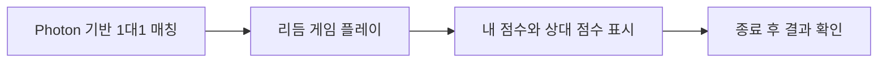
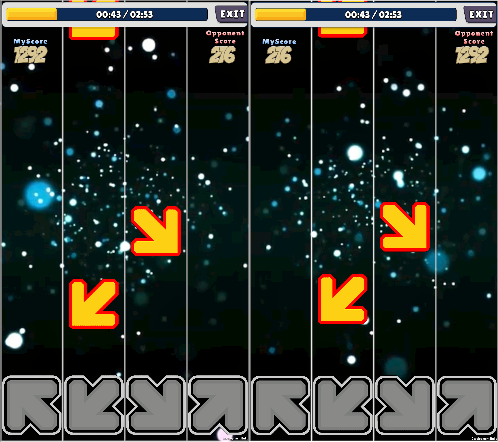
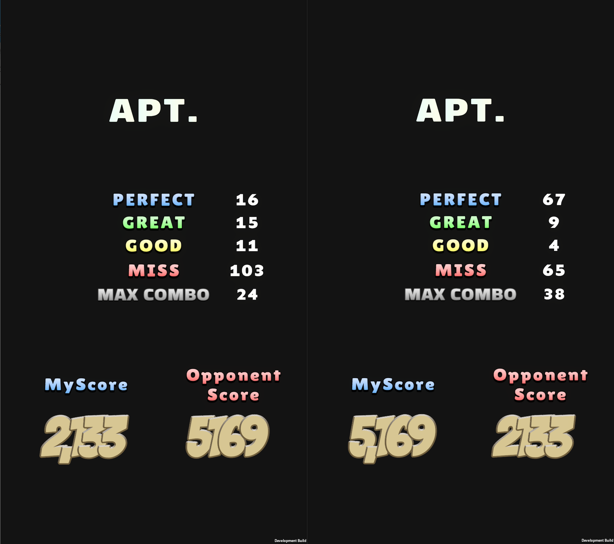

# Photon 기반 1대1 리듬 게임

## 경쟁 플레이를 추가한 이유

혼자 음악에 맞춰 기록을 쌓는 리듬 게임에, 다른 사용자와 점수를 겨루는 재미를 더하고자 했습니다. Photon 예제 코드를 바탕으로 실시간 1대1 매칭과 리듬 게임 플레이 환경을 직접 구현했습니다.

## 구현한 범위

- Photon 예제와 리듬 게임을 연결한 실시간 1대1 플레이
- 플레이 중 내 점수와 상대 점수 표시
- 종료 후 개별 판정 기록과 내 점수·상대 점수 표시

Photon 예제 코드를 기반으로 게임에 필요한 응용 구현을 직접 담당했습니다. 기존 C++ 로그인·기록 서버 연동과는 별개의 작업입니다.

## 사용자 흐름

매칭부터 게임 진행, 결과 확인까지의 사용자 흐름입니다.

## 확인한 결과

### 플레이 중 상대 점수 표시

왼쪽 내 점수 1,292점이 오른쪽 상대 점수에 표시되고, 반대쪽의 216점도 서로 대응합니다.

### 종료 후 결과 확인

최종 점수 2,133점과 5,169점이 각 화면의 내 점수·상대 점수에 대응합니다. 각자의 판정 기록과 최대 콤보도 결과 화면에서 확인할 수 있습니다.

두 화면은 점수 표시와 결과 연결을 보여주는 자료입니다. 정밀한 시간 동기화나 네트워크 지연은 별도로 측정하지 않았습니다.

## 공개 범위

실행 화면은 공개를 확인받은 자료로, 회사·제품명이 있는 상단 창 제목줄만 잘랐습니다. 점수와 게임 UI는 원본 그대로 유지했습니다. 회사 원본 코드는 포함하지 않습니다.

[인터랙티브 CodeMap에서 보기](https://sj97p.github.io/Interactive-Game-Systems-CodeMap/#case=photon-rhythm)
